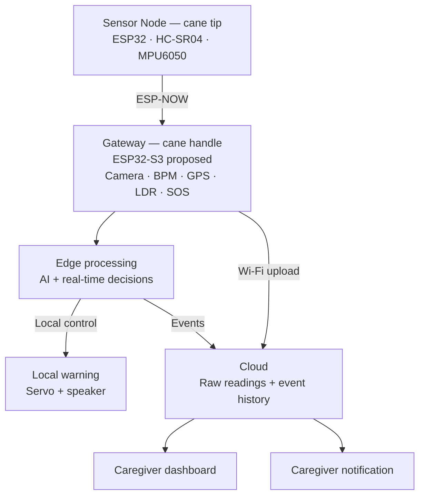

# SYSTEM ARCHITECTURE — Smart Cane (TMR Praao)

**Version:** 0.1 (Draft for team review)  
**Date:** 10 November 2026 (ICT)  
**Architect:** Thiti Wanganuttara — System Architect & Integration  
**Approval:** Pending. This document is a proposed system-level baseline, **not** an approved implementation specification.

> Scope discipline: This document defines topology, data flow, interface boundaries, non-functional constraints, and integration criteria. It does **not** assign or implement sensor firmware, gateway/cloud implementation, AI training, dashboard design, or PM test management.

## 1. Project purpose

Build a prototype smart cane that assists visually impaired users through obstacle awareness, local physical/audio warnings, and caregiver visibility of important events.

**Architecture goals**

1. Collect at least five distinct sensor types across a Sensor Node and a Gateway (at least two types on each).
2. Make immediate local warnings independent of Internet and cloud availability.
3. Use an actual AI model output in a system decision or actuator action (M4 closed loop).
4. Preserve raw telemetry in cloud storage and expose it through a caregiver dashboard.
5. Deliver important SOS or other critical events to a caregiver.
6. Use explicit node identity and interfaces supporting multiple sensor nodes.
7. Permit repeatable end-to-end and failure/recovery integration checks.

This is an assistive **prototype**, not a replacement for an ordinary cane or a certified safety device.

## 2. Proposed system topology

The following reflects the submitted **Embedded System Proposal**, not verified final hardware.

| Layer | Location | Proposed hardware/services | Role |
|---|---|---|---|
| Sensor Node | Cane tip | ESP32 + HC-SR04 + MPU6050 | Collect distance and movement readings; transmit to Gateway |
| Gateway / edge | Cane handle | **ESP32-S3 (proposed)** + camera + MAX30102 + GPS NEO-6M + LDR + SOS button | Combine local and remote readings, evaluate AI/events, coordinate local outputs and Internet uplink |
| Local output | Cane handle | SG90 servo + DFPlayer Mini/speaker | Physical tactile warning and audio feedback |
| Cloud | Internet | Platform **TBD** | Persist raw sensor data and system events |
| Caregiver experience | Web/mobile | Dashboard + notification service; Discord webhook proposed | Show location/status/history and alert caregivers |

**Hardware discrepancy requiring review:** The BOM retailer item is labeled “ESP32-CAM with camera and upload module.” That title does not confirm the ESP32-S3 specified in the proposal. Do not freeze the pin map, RAM budget, AI deployment plan or Gateway architecture until the exact board/chip/PSRAM has been confirmed. A plain ESP32-CAM also exposes very few free GPIO once the camera is wired; Gateway needs I2C (MAX30102), UART (GPS), ADC (LDR), SOS button, servo and audio, so pin feasibility must be checked too.

**Second hardware discrepancy (found 14 Nov 2026):** the proposal specifies **DFPlayer Mini + speaker**, but the BOM audio link is a **MAX98357 I2S amplifier**. These are different parts (DFPlayer plays files from SD by itself; MAX98357 only amplifies an I2S stream the ESP32 must generate). Gateway owner to confirm which part is actually bought; update proposal/BOM to match.

### 2.1 Logical diagram

### 2.2 Two separate execution paths

**Real-time local path:** Sensor Node / Gateway sensors / camera → Gateway edge evaluation → Servo/audio. Local obstacle warnings must not wait for a Cloud response.

**Remote monitoring path:** Gateway raw telemetry and event records → Cloud persistent storage → Dashboard and important-event notification. Internet loss may delay this path but must not silently disable local warning behavior.

The exact Cloud platform, application transport (HTTPS/MQTT), API endpoints, notification triggering location, persistence schema, and queue capacity are **not yet agreed**.

## 3. Component interfaces and team boundaries

| Component | Input | Output/interface | Component owner per proposal |
|---|---|---|---|
| Sensor Node | HC-SR04 and MPU6050 measurements | Identifiable telemetry over ESP-NOW | Pongsinachai Treepol |
| Gateway & Cloud | Node telemetry, camera, BPM, GPS, LDR, SOS | Decisions, local output commands, cloud records | Chananphat Tacharoenmuang |
| Dashboard | Stored cloud data/status | Caregiver map, BPM, history, events | Udomchok Chaikhamrongkul |
| PM & Test Lead | Team milestones and test evidence | Schedule, formal test plan and performance metrics | Thapanakorn Chitvibulsophon |
| **System Architect & Integration** | Requirements and independently delivered components | **Architecture, interface definitions, integration compatibility and integration acceptance** | **Thiti Wanganuttara** |

**Boundary:** The architect describes the data crossing each component boundary and verifies the connection. Changes *inside* a component belong to its owner unless agreed explicitly. The PM retains ownership of the overall test plan.

## 4. System-level data/event flows

### F1 — Low-level obstacle
1. HC-SR04 on the Sensor Node produces a distance measurement.
2. Sensor Node sends its measurement and node identity to Gateway over ESP-NOW.
3. Gateway validates freshness and evaluates the reading with the agreed edge logic.
4. Gateway may issue servo and/or audio warning; corresponding telemetry/events can be uploaded asynchronously.

**Not frozen:** sampling rate, distance threshold, alert priority, servo movement and audio content.

### F2 — Elevated obstacle / AI
1. The Gateway camera supplies image data to a proposed on-device AI model.
2. Gateway converts model output into a meaningful **local decision or actuator action**.
3. The AI outcome can be recorded as an event in Cloud.

**Feasibility condition:** Exact Gateway hardware must demonstrate camera + inference + networking + local response with measurable memory use and latency. Camera capture alone does not satisfy AI closed loop.

### F3 — Movement / suspected fall
1. MPU6050 is physically located on the **cane-tip Node**.
2. Its motion data is forwarded to Gateway for event evaluation.
3. Confirmed event semantics and caregiver alert policy are **TBD**.

**Important safety distinction:** Detecting a dropped/fallen *cane* is not the same as proving that a *person* fell. Use “suspected fall / cane drop” until a validated algorithm and acceptance method exist.

### F4 — SOS
1. User presses the Gateway SOS button (interrupt-driven design proposed under E2).
2. Gateway creates an emergency event with a unique identifier and local acknowledgement.
3. Notify caregiver when connectivity permits. Include GPS location only when fix is valid; otherwise flag unavailable/stale coordinates.
4. Retries/replays must avoid duplicate emergency events/alerts.

### F5 — Raw telemetry & dashboard
Gateway uploads raw sensor readings (not summaries only) and independently derived events. Cloud stores records containing origin/node identity, observation/receipt times, units and data validity. Dashboard displays current state, history and stale/offline conditions.

Detailed fields, cloud APIs and data retention remain for the owning developers to agree under the interface contract.

## 5. Interface boundary register

| ID | Interface | Contract that must be agreed |
|---|---|---|
| IF-01 | Sensor Node ↔ Gateway (ESP-NOW) | Version, node_id, sequence, units, sample time, payload size, ACK/retry, freshness and error behavior |
| IF-02 | Gateway → Servo / speaker | Command/event types, priority, timing, safe stop, invalid/stale input behavior |
| IF-03 | Gateway → Cloud | HTTPS/MQTT choice, device identity, authenticated transport, raw data/event schema, offline buffering/replay |
| IF-04 | Cloud → Dashboard | Current/historical data format, node identity, timestamps, offline/stale states |
| IF-05 | Emergency notification | Event ID, severity, valid/stale GPS status, retries, duplicate suppression |
| IF-06 | AI output → Gateway decision | Model version, label/score, inference time, event classification, intended local action |

A later `COMMUNICATION_PROTOCOL.md` will define packet-level details. A later `INTERFACE_CONTRACT.md` will define approved field-level I/O between owners.

**Proposed time handling (not yet approved):** Node sends a monotonic local sample tick; Gateway adds a UTC receipt timestamp. Do not treat unsynchronized MCU uptime as wall-clock time.

## 6. Scalability

Design the schema and Gateway state for **more than one Sensor Node**, even if the first prototype has one physical Node:

- Every message includes stable `node_id`, message/sequence identity and schema version.
- Readings, errors, last-seen time and dashboard views distinguish nodes.
- Missing/stale or duplicated packets are identified per node.
- Simulated nodes (if used) must be clearly distinguished from physical readings.

Course scoring options: multi-node-ready software (1 point), 1 physical + 2 simultaneous simulated nodes (2 points), ≥2 simultaneous physical nodes (3 points). **Team/PM must choose the actual target; the current BOM lists one physical Node.**

## 7. Requirements mapped to architecture

| Item | Architecture allocation | Verification status |
|---|---|---|
| M1: ≥5 sensor types, ≥2 per Node/Gateway | Node: HC-SR04, MPU6050; Gateway: MAX30102, GPS, LDR; camera separately | Proposed only; actual wiring/read/use not verified |
| M2: ≥1 physical actuator | SG90 servo on Gateway | Proposed; speaker does **not** count |
| M3: Node → Gateway link | ESP-NOW | Proposed; not measured |
| M4: AI closed loop | Gateway model output used in a real local decision/action | Proposed; feasibility unverified |
| M5: Raw Cloud data + dashboard | Gateway uplink → persistent raw store → caregiver UI | Cloud choice TBD |
| M6: Notifications | Discord webhook in proposal | Delivery not verified |
| M7: Safety | Protected battery, safe servo stop, safe wiring and controlled testing | Design/test pending |
| M8: Publicly accessible Git with every member's commits | Shared repo workflow | Repo status not checked |

The proposal selected **E1 FreeRTOS, E2 interrupt input, E3 low power, E4 reliable communication, E7 on-device AI** for Embedded Engineering Depth. These are planned items, not earned points. E3 sleep design must not undermine urgent obstacle warnings. Each selected item needs a demonstrable implementation and explanation by its owner.

## 8. Non-functional architecture constraints

- **Latency:** Local warning path avoids cloud round-trips; define and measure acceptable latency after use cases and actual hardware are confirmed.
- **Resilience:** A Wi-Fi/Cloud outage must be visibly separate from an ESP-NOW link outage. Gateway/cloud recovery needs an agreed retry and bounded buffer policy (E4).
- **Radio co-existence:** Gateway use of ESP-NOW with infrastructure Wi-Fi requires coordinated radio-channel behavior; validate using the actual mobile hotspot before checkpoint/final demo.
- **Freshness:** Missing, invalid and stale sensor data must not be displayed as fresh or as zero.
- **Physical safety:** Servo requires safe limits/timeout; battery charging/protection and wiring require review. Start tests in controlled environments.
- **Privacy:** GPS and heart-rate records must have access-control and retention decisions before real user deployment.

## 9. Open architecture decisions / risks

| ID | Severity | Decision required | Consult |
|---|---|---|---|
| ADR-01 | **P0** | Exact Gateway board: proposal ESP32-S3 vs listed ESP32-CAM; verify chip, PSRAM, available GPIO and whether bought | Hardware purchaser + Gateway owner |
| ADR-02 | **P0** | Vision/model feasibility and acceptable inference latency on that exact board | Gateway / model owner |
| ADR-03 | **P0** | Cloud storage/platform, protocol and data API | Gateway/Cloud + Dashboard |
| ADR-04 | High | What “fall” means with a cane-mounted MPU6050; avoid false claims | Team + PM/Test |
| ADR-05 | High | ESP-NOW/Wi-Fi channel policy, hotspot and reconnect behavior | Sensor Node + Gateway |
| ADR-06 | High | Power, safe actuator control, battery/protection and pin-resource compatibility | Component hardware owners |
| ADR-07 | Medium | Multi-node demonstration target for scalability points | PM + team |
| ADR-08 | Medium | Event de-duplication, GPS validity, Cloud retention and data privacy | Cloud + Dashboard |

**No decisions above are approved by this file.** Use team review and a revision record to close them. Do not change another owner's design unilaterally.

## 10. Architect-owned integration acceptance

These are cross-component interface checks, **not** the PM's formal system test plan:

- [ ] Each owner has reviewed the boundaries and agreed units, timestamps, IDs and versioning.
- [ ] Gateway recognizes a Sensor Node and handles malformed or stale messages safely.
- [ ] A traceable reading passes **physical Node → Gateway → Cloud raw record → Dashboard**.
- [ ] AI model output is connected to an actual local decision/action (not model demo alone).
- [ ] Local warning continues when Internet/Cloud is unavailable.
- [ ] SOS creates a traceable event with correct valid/stale location treatment and no duplicate alert on replay.
- [ ] Multiple Node identities remain distinct in the chosen scalability demonstration.
- [ ] Interface recovery behavior is observable, and failures are reported to the relevant component owner.

**Checkpoint:** By **20 November 2026, 23:59 ICT**, the ≤2-minute video must demonstrate end-to-end Node → Gateway → Cloud → Dashboard.  
**Final:** **8 December 2026** live demo/report/source. Architect's report contribution includes overview, data flow, components and approved message format.

## 11. Architect deliverables and change control

1. **This file:** `SYSTEM_ARCHITECTURE.md` (Draft v0.1).
2. Next: `COMMUNICATION_PROTOCOL.md` (message structure, transport semantics).
3. After protocol review: `INTERFACE_CONTRACT.md` (approved inputs/outputs).
4. Later: `INTEGRATION_PLAN.md` (cross-component smoke tests, sequencing and acceptance).

**Revision log**

| Version | Date | Summary | Approval |
|---|---|---|---|
| v0.1 | 10 Nov 2026 | Architecture drafted from course brief and proposal; risks/TBD explicitly captured | Pending team review |

**Sources reviewed:** `Embedded System Proposal.pdf`; `Embedded System (CEDT) - Final Project 2026.pdf`; `Smart Cane - Item.pdf`. Existing `README.md` was not altered.
